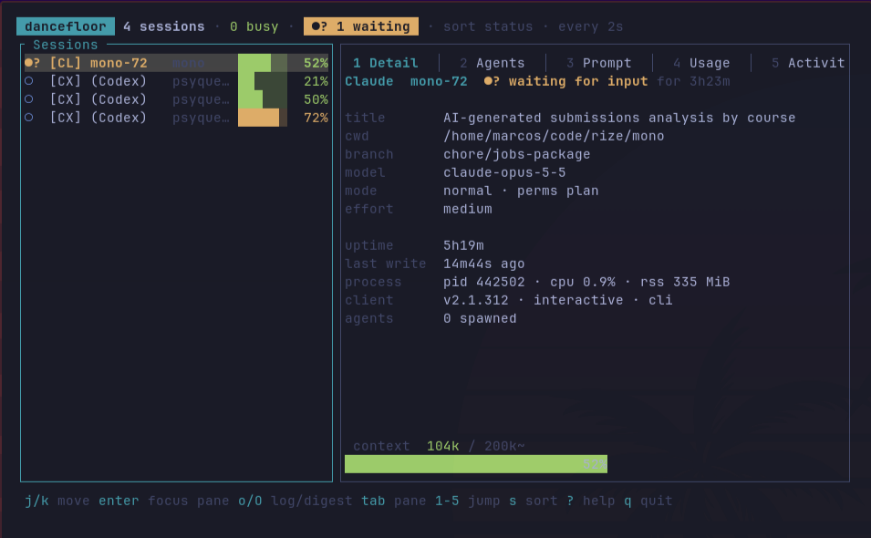

# dancefloor

A terminal dashboard for your live Claude Code, Codex, and Pi sessions. It is `lazydocker` for agents.



## Features

- **Finds every live session** of Claude Code, Codex, and Pi on this machine.
- **Shows the status** of each session: waiting for you, busy, or idle.
- **Shows context use** as a coloured bar per session.
- **Lists subagents** and opens the full thread of each one.
- **Streams tool calls**, newest first. You can open a call or copy its command.
- **Opens the raw log** or a readable Markdown digest in your editor.
- **Prints a plain-text table** with `--once`, for scripts and pipes.
- **Read-only.** It reads local files. It does not call an API or change agent state.

## Install

```sh
cargo install --path .
```

The binary goes to `~/.cargo/bin/dancefloor`.

## Use

```sh
dancefloor                        # the dashboard
dancefloor --once                 # one plain-text table, then exit
dancefloor --interval 5           # refresh every 5 seconds instead of 2
dancefloor --context-limit 1m     # pin the context window for every session
dancefloor --context-default 1m   # the window to assume when a session proves nothing
```

- A token count can be `1m`, `200k`, or `750000`.
- All flags also accept `--flag=value`.
- `--interval` (or `-i`) takes 1 to 3600 seconds.
- `-h` shows help. `-V` shows the version.

### The `--once` table

The table has these columns: status, client, name, directory, context %, model, and uptime.
Provider errors go to stderr, so the table stays clean in a pipe.

## The session list

Each row shows:

- **Status glyph:**
  - `●?` (yellow): the session waits for you.
  - `●`: busy.
  - `○`: idle.
- **Name** of the session.
- **Context bar and percent:**
  - Green: below 60%.
  - Yellow: 60% to 85%.
  - Red: 85% and above.

Press `s` to change the sort order:

- **Status:** waiting sessions first, then busy, then idle. Ties sort by name.
- **Context:** fullest first.
- **Uptime:** longest-running first.
- **Directory:** A to Z.

## Keys

### Session list and panes

| Key                     | Action                                                     |
| ----------------------- | ---------------------------------------------------------- |
| `j` `k` `↑` `↓`         | Move between sessions, or move the cursor in a focused pane |
| `enter`                 | Focus the pane, then open the tool call or agent under the cursor |
| `esc`                   | Go back to the session list. From the list, quit.          |
| `tab` `l` `→`           | Next pane                                                  |
| `shift-tab` `h` `←`     | Previous pane                                              |
| `1` to `5`              | Go to Detail, Agents, Prompt, Usage, or Activity           |
| `o`                     | Open the raw session log in your editor                    |
| `O`                     | Open a digest of the session in your editor                |
| `s`                     | Change the sort order                                      |
| `r`                     | Refresh now                                                |
| `?`                     | Help                                                       |
| `q` `ctrl-c`            | Quit                                                       |

The coloured border shows which half has the keys: the session list or the pane.

### Open agent thread

| Key                     | Action                       |
| ----------------------- | ---------------------------- |
| `j` `k` `↑` `↓`         | Scroll one line              |
| `space` `pgdn`          | Page down                    |
| `b` `pgup`              | Page up                      |
| `g` `home`              | Go to the top                |
| `G` `end`               | Go to the end                |
| `o`                     | Open the agent's raw log     |
| `esc` `enter` `q`       | Close the thread             |

### Open tool call

| Key                     | Action                         |
| ----------------------- | ------------------------------ |
| `y`                     | Copy the full command          |
| `esc` `enter` `q`       | Close the tool call            |

## The panes

### 1. Detail

- Session name and status, and how long it has had that status.
- Directory, git branch, worktree, and pull request.
- Model and permission mode.
- Uptime, and CPU and memory of the process.

### 2. Agents

- One row for each subagent that the session started.
- Each row shows the agent type, its prompt or skill, and how long it has been idle.
- Press `enter` on an agent to open its thread: the prompt, the thinking, the tool calls, and
  the replies.
- The thread reloads when the agent writes more.

### 3. Prompt

- The last prompt that the user sent.
- The session title above it.

### 4. Usage

- The newest request, split into input, cache read, cache write, and output tokens.
- Totals for recent activity in the part of the transcript that was read.

### 5. Activity

- The recap that Claude writes when you leave a session. A recap is a `/config` setting, so
  most sessions do not have one.
- The skill or MCP tool that drives the turn.
- The length of the last turn.
- The files that the session edited.
- Every tool call, newest first. Each row shows the summary of the call and the command.
- Press `enter` to open a call. Press `y` to copy its full command.

## Editor and digest

- `o` and `O` use `$VISUAL`, then `$EDITOR`, then `vi`.
- The dashboard waits until the editor closes.
- The digest is a Markdown file in `$TMPDIR/dancefloor/`. It contains:
  - The prompts and the thinking.
  - Each tool call with its full command.
  - One section for each agent, so you can see which agent did what.
  - For Claude Code, the type and task of each subagent.
- The digest reads the full log, not only the tail.
- Codex usually encrypts its reasoning. The digest shows `(encrypted)` for those steps.

## Config

Set the default context window in `~/.config/dancefloor/config.json`. Then you do not need
`--context-default` on each run. `dancefloor` uses `$XDG_CONFIG_HOME` when it is set.

```json
{
  "default_context_limit": "1m"
}
```

- The value takes the same shorthand as the flag, or a plain number.
- `--context-default` overrides the file.
- A missing or incomplete file is not an error.

## Where the data comes from

`dancefloor` reads files that the clients already write. It does not call an API. It does not
write to Claude Code, Codex, or Pi state.

| Source | What it gives |
| ------ | ------------- |
| `~/.claude/sessions/<pid>.json` | The live session registry: pid, session id, directory, name, and status |
| `~/.claude/projects/<dir>/<session>.jsonl` | Token usage, model, title, branch, permission mode, worktree, pull request, last prompt, and activity |
| `~/.claude/projects/<dir>/<session>/subagents/` | One `meta.json` for each subagent |
| `$CODEX_HOME/sessions/YYYY/MM/DD/rollout-*.jsonl` | Codex session metadata, lifecycle, messages, tools, and token events |
| `$PI_CODING_AGENT_SESSION_DIR` (or `~/.pi/agent/sessions`) | Pi session headers, active-branch messages, model changes, and tools |
| `ps` | CPU and memory for each session process |
| `wl-copy`, `xclip`, `xsel`, or `pbcopy` | The first one installed, to copy a tool call |

- A registry file stays after its process stops. `dancefloor` checks each entry against `ps`,
  so a crashed session goes away on the next refresh.
- The process id identifies a session, not the directory. Two sessions often run in the same
  directory.
- Codex uses `$CODEX_HOME` (default `~/.codex`).
- Pi uses `$PI_CODING_AGENT_DIR` (default `~/.pi/agent`) and `$PI_CODING_AGENT_SESSION_DIR`
  (default its `sessions` directory).
- A missing provider directory counts as empty.
- A process with no transcript shows as a process-only row, where the client supports it.

## Known limits

### The context limit is a best guess

Claude Code records the base model id, such as `claude-opus-5`, even for the `[1m]`
long-context variant. So the log does not state the window. `dancefloor` uses the strongest
signal it has, in this order:

| Signal      | Where it comes from                                                  |
| ----------- | -------------------------------------------------------------------- |
| Override    | `--context-limit`                                                    |
| Observed    | Usage is already past 200k, so the window must be 1M                 |
| Recorded    | A `cost-state` line that billed this model at `[1m]`                 |
| Configured  | The model that Claude Code settings name for the session's directory |
| Declared    | `--context-default`, or the config file                              |
| Assumed     | Nothing else applies, so 200k                                        |

- A live session often has none of the first four signals:
  - Claude Code writes `cost-state` at shutdown. A running session has none, unless it
    resumed from a session that ended.
  - Settings only help when they name a `model`. Many people pick the model with `/model`.
- So a new 1M session shows as 200k until its usage passes 200k. Set
  `default_context_limit` to fix this.
- A `~` after the limit means it is the 200k fallback.

### Rate limits are not shown

Claude Code sends the 5-hour and 7-day figures to the status line hook on stdin. It does not
write them to disk, so other tools cannot read them.

### Recent activity covers only the transcript tail

- A transcript can grow very large, so `dancefloor` reads only the last megabyte.
- The Usage pane tells you this.
- The last prompt is the exception. `dancefloor` searches further back for it, because a long
  turn can push it out of that window.

## Develop

```sh
cargo test          # unit tests plus the render suite
cargo run -- --once
```

- The render suite draws the real UI on a test backend at six terminal sizes, down to 1x1.
- `ratatui` panics when a fixed-size region does not fit. So a new panel with an unguarded
  length constraint fails the tests, and does not break the app on a small terminal.
